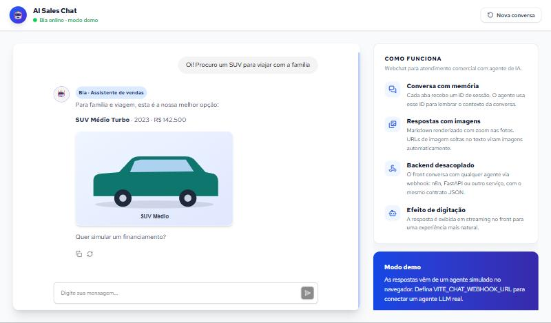
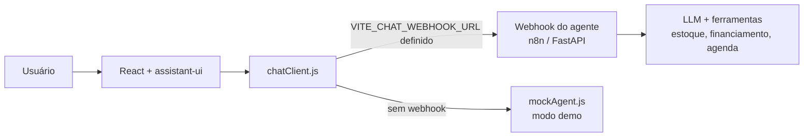

# AI Sales Chat

Webchat de atendimento comercial com **agente de IA**: conversa com memória, respostas em markdown com imagens e efeito de digitação. O front é desacoplado do agente e fala com qualquer backend via webhook (n8n, FastAPI etc.).

Tem um **modo demo** com agente simulado: roda sem backend, sem chave de API e sem custo.



## Funcionalidades

- 💬 **Conversa com memória**: cada aba recebe um ID de sessão (`crypto.randomUUID`), que o agente usa para manter o contexto
- 🖼️ **Markdown com imagens**: respostas renderizadas com zoom nas fotos. URLs de imagem soltas no texto viram imagens automaticamente
- ⌨️ **Efeito de digitação**: a resposta aparece em streaming na interface, com cancelamento pelo botão de parar
- 🔌 **Backend plugável**: o contrato do webhook é simples e aceita os formatos de resposta mais comuns
- 🧪 **Modo demo**: agente simulado no navegador, útil para testar a interface e para apresentações
- 🇧🇷 Interface em português, com sugestões de perguntas na tela inicial

## Arquitetura



O fluxo de uma mensagem:

1. O `Thread` do assistant-ui chama o adapter do `useLocalRuntime`
2. O `chatClient` envia `{ chatInput, sessionId }` para o webhook (ou para o agente simulado)
3. A resposta passa por `extractReply` (normaliza o formato) e `linkifyImages` (corrige imagens sem markdown)
4. O `typewriter` entrega o texto em pedaços para o efeito de digitação

### Contrato do webhook

```http
POST {VITE_CHAT_WEBHOOK_URL}
Content-Type: application/json

{ "chatInput": "Quais carros vocês têm?", "sessionId": "8c1f…" }
```

Respostas aceitas: `{ "output": "..." }`, `{ "message": "..." }`, `{ "text": "..." }`, `{ "response": "..." }`, uma string, ou um array com um desses (formato padrão do n8n).

## Stack

React 19 · Vite 7 · Tailwind CSS 4 · [assistant-ui](https://github.com/assistant-ui/assistant-ui) · lucide-react · react-medium-image-zoom

## Como rodar

```bash
npm install
npm run dev
```

Sem configuração nenhuma, o app abre no **modo demo**. Para conectar um agente real:

```bash
cp .env.example .env
# edite .env e defina VITE_CHAT_WEBHOOK_URL
```

Outros comandos: `npm run build` (build de produção), `npm run preview` (serve o build) e `npm run lint`.

> **Segurança:** variáveis `VITE_*` vão para o bundle do navegador, ou seja, ficam públicas. Em produção, aponte para um endpoint que valide origem e aplique rate limit (ou um proxy no seu backend), nunca para um webhook sem proteção.

## Estrutura

```
src/
├── App.jsx                 # "Nova conversa" remonta o chat com sessão nova
├── components/
│   ├── Chat.jsx            # layout, runtime do assistant-ui e adapter de streaming
│   ├── MarkdownText.jsx    # renderização de markdown com zoom nas imagens
│   └── InfoPanel.jsx       # painel lateral "Como funciona"
└── lib/
    ├── chatClient.js       # envio ao webhook, modo demo e efeito de digitação
    ├── formatReply.js      # normalização da resposta e correção de imagens
    ├── mockAgent.js        # agente simulado (regras por intenção)
    └── session.js          # ID de sessão por aba
public/cars/                # ilustrações próprias usadas no modo demo
```

## Autor

**Renato Xavier**, desenvolvedor de software com foco em IA generativa.
[LinkedIn](https://www.linkedin.com/in/renato-xavier-pereira-975225306/) · devrxp@gmail.com
